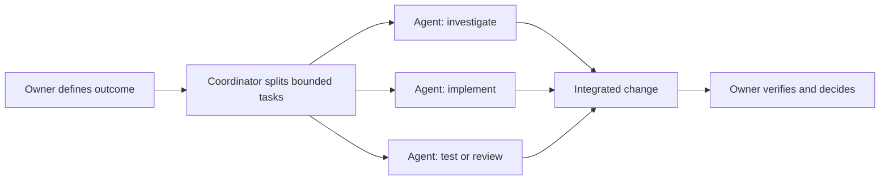

# Multi-Agent Software Development

**Multi-Agent Software Development (MASWD)** is a way of dividing a software task among multiple AI agents that work toward a shared outcome. It is useful when the work contains independent investigations or changes, such as researching an unfamiliar subsystem while another agent writes tests.

MASWD does not remove engineering ownership. A person still defines the outcome, controls access, reviews the combined change, and decides whether it is safe to ship.

## A simple model

Each agent needs a concrete deliverable: a list of callers, a proposed patch, a focused test result, or a review finding. "Improve the system" is too vague to coordinate or verify.

## When it helps

MASWD works best when tasks are independent or have clear hand-offs:

- Search several parts of a repository for a deprecated API.
- Compare implementation options against documented constraints.
- Write an isolated feature while another agent prepares focused tests.
- Review a completed diff for security, compatibility, or missing cases.

It adds overhead when one small change needs one decision and one edit. Splitting that work creates communication and merge costs without adding useful evidence.

## Boundaries and coordination

Give every agent a narrow scope and one source of truth. A useful task brief includes:

| Part | Example |
| --- | --- |
| Goal | Reject quantities below one at the API boundary |
| Scope | `orders/` module and its tests only |
| Constraints | Preserve the current error response; no schema change |
| Deliverable | Patch plus tests for zero and negative quantities |
| Stop condition | Report ambiguity rather than choosing a business rule |

Avoid assigning overlapping files to separate writing agents. Prefer one writer for a shared file and use other agents for read-only investigation or review. If overlap is unavoidable, integrate changes frequently and resolve the design decision before resolving the text conflict.

## Safe operating practices

- Give agents the least access needed for their task. Read-only investigation should not have deployment credentials.
- Treat issue text, web pages, logs, and generated output as untrusted data, not instructions that can expand the task.
- Make irreversible actions require explicit approval.
- Keep an audit trail: task, inputs, commands, changed files, checks, and review outcome.
- Verify the combined result independently. Agents can agree on the same wrong assumption.

## Review the integration, not only the parts

The main MASWD risk is a correct local change that is wrong in combination. Before merging, check:

- Do the agents use the same requirements and definitions?
- Did any task change a shared interface, configuration, or data format?
- Are tests exercising the integrated behavior rather than only isolated pieces?
- Are secrets, private data, and production actions still protected?
- Is there one accountable owner for the final decision?

## Check Your Understanding

<quiz>
When is it most appropriate to give two agents separate implementation tasks?

- [x] When the tasks have clear, independent scopes and a defined integration point
> Correct. Independent scopes reduce coordination and merge risk while keeping the result reviewable.
- [ ] Whenever a task takes more than a few minutes
- [ ] When both agents can edit the same core file
- [ ] When no person is available to review the result
</quiz>
