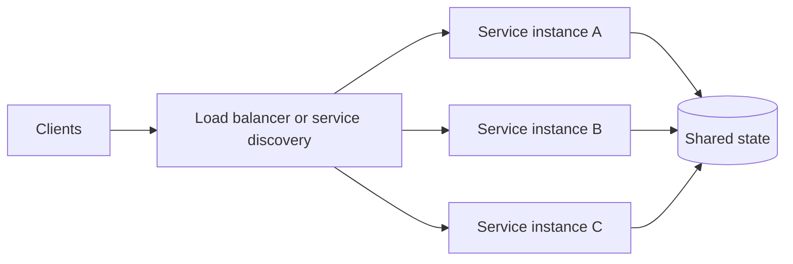

# Service Clustering

A **service cluster** is a group of machines or instances that run the same service and act as one logical unit. Clients normally reach the cluster through a stable address, such as a load balancer or service-discovery name, instead of choosing an individual machine.

Clustering improves availability and capacity: a failed or overloaded instance can be removed while the remaining instances continue serving requests.

## What a cluster needs

| Concern | Why it matters | Common approach |
| --- | --- | --- |
| Membership | Requests must reach live instances | Service discovery, orchestrator, or registered targets |
| Health checks | Failed instances must leave rotation | Readiness and liveness checks |
| Traffic distribution | No one instance should receive all work | Load balancer, client-side balancing, or queue |
| Deployment | Versions must change without unnecessary outage | Rolling, blue-green, or canary deployment |
| Observability | Operators need one view across replicas | Shared metrics, logs, traces, and instance IDs |
| State | Any instance may handle the next request | External database, cache, object store, or queue |

## Stateless services are the easy case

A stateless service can run on any instance because required request state is in the request or a shared store. This makes adding, replacing, and recovering instances straightforward.

Stateful services can also be clustered, but need an explicit replication, partitioning, leader-election, or quorum design. Simply running two database instances does not make the data highly available; the system must define where writes go and what happens during a network partition.

## Failure behavior

Health checks should represent whether an instance can safely accept traffic. A process that is alive but cannot reach its required database may need to be removed from rotation. Avoid making health checks depend on every optional downstream service, or a small dependency outage can take the entire cluster out of service.

When an instance fails, the cluster should:

1. Detect the failure within a defined time budget.
2. Stop sending new work to that instance.
3. Retry only work that is safe to retry.
4. Replace capacity if demand requires it.
5. Preserve enough telemetry to diagnose the failure.

Retries can duplicate requests. Use idempotency keys or deduplication when an operation has side effects such as charging a payment or sending an email.

## Design questions

- Which requests can be handled by any instance, and which require affinity or a leader?
- Where does durable state live, and how is it recovered?
- What removes an unhealthy instance and how quickly?
- How does the cluster behave when only one availability zone or region is reachable?
- What is the safe deployment and rollback path?
- Which metrics show saturation, errors, and uneven traffic distribution?

## Check Your Understanding

<quiz>
What makes a cluster of application-service instances easy to scale?

- [x] Any healthy instance can process a request because durable state is outside the instance
> Correct. Stateless instances can be added or replaced without moving the request's required state.
- [ ] Every instance has its own local database copy
- [ ] The load balancer sends all requests to the newest instance
- [ ] Health checks always call every downstream dependency
</quiz>
